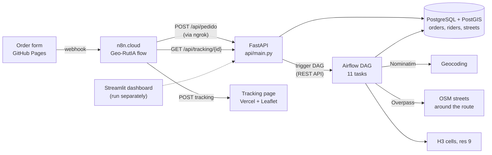

# RutIA

[](requirements-api.txt)
[](LICENSE)

[🇦🇷 Español](README.es.md)

**You order a burger; behind it, a small spatial engine wakes up. RutIA is a delivery demo that makes visible the geospatial work an app like Rappi or Glovo hides: geocoding, H3 hexagons, street networks from OpenStreetMap, routing in PostGIS and a rider moving point by point on a map.**

> **The live demo is offline.** It ran on a local Docker stack exposed through ngrok during a 2025 webinar. The [order form](https://oechenique.github.io/la-geografica-menu/) and the [tracking page](https://la-geografica-tracking.vercel.app/) still load, but there is no backend behind them.

Built in August 2025 for a GeoDojo webinar, as a teaching piece: every step that usually happens in milliseconds is a named, logged task you can follow.

## How it works



An order from the form reaches an n8n flow, which calls the API. The API stores the order, assigns a rider using H3 rings around the store and triggers the Airflow DAG with the order as `conf`. The DAG runs eleven tasks in a chain: reception → geocoding → H3 analysis → H3 route trace → OSM preparation → OSM extraction → PostGIS storage → Dijkstra routing → vector tracking → notifications → wrap-up. n8n reads the route from the API and posts it to the tracking page on Vercel, which moves the rider along it.

## What's in it

- **H3 for dispatch**: the store, the customer and the riders live in resolution-9 cells; riders are placed on rings around the store and the hex distance gives a first estimate before any routing ([`core/spatial_engine.py`](core/spatial_engine.py)).
- **Only the streets you need**: Overpass is queried with the bounding box of the H3 cells along the store–customer route, not the whole city, and the result goes into PostGIS ([`airflow/dags/tasks/osm_extraction_tasks.py`](airflow/dags/tasks/osm_extraction_tasks.py)).
- **Routing with a way out**: the API tries `pgr_dijkstra` over the extracted streets and, if the network is missing or too small, falls back to a straight route so the demo never gets stuck ([`api/main.py`](api/main.py)).
- **Orchestration you can watch**: every step is an Airflow task with logs, so the webinar could show the pipeline running live, one order at a time.

## Limits

- **pgRouting: not verified.** The routing query uses `pgr_dijkstra`, but the `postgis/postgis:15-3.3` image does not ship pgRouting and `database/schemas/01_setup.sql` only creates `postgis` and `postgis_topology`. When the extension is missing, the API takes the straight-line fallback.
- **Two compose files.** The root `docker-compose.yml` runs Postgres, the API and Airflow (`standalone`); `airflow/docker-compose.airflow.yml` is an older, separate Airflow that talks to the host. The root one is the reference.
- **Default credentials are for the local demo only.** `docker-compose.yml` and `api/main.py` carry default passwords and Airflow keys so the stack starts with no setup; change them via `.env` before deploying anywhere.
- Airflow uses the same database as the app, and the n8n flow points to an ngrok URL that no longer exists.
- Streamlit has a Dockerfile but no service in the compose; it runs on its own against `localhost:3000`.

## What I'd do today

- **Infrastructure as code and real secrets**: Terraform for the cloud pieces and a secrets manager instead of a `.env` and defaults in the compose.
- **Layers instead of one shared database**: raw orders and OSM extracts, cleaned streets and routes, and serving tables, kept apart from Airflow's own metadata (a small Medallion layout).
- **CI that runs the spatial functions**: unit tests for H3 assignment and routing on a tiny fixture network, plus a compose that starts clean in a GitHub Actions job.
- **A data contract for the order**: the JSON from n8n to the API validated with a versioned Pydantic model, so a change in the form fails loudly at the door.

<details>
<summary><b>Run it locally</b></summary>

Requirements: Docker Desktop and ports 3000 (API), 8080 (Airflow) and 5432 (Postgres) free. Steps for Windows in [`docs/setup/installation_windows.md`](docs/setup/installation_windows.md).

```bash
git clone https://github.com/oechenique/RutIA.git
cd RutIA
cp .env.example .env        # set the store location and change every "change-me"
docker compose up -d
```

- API: http://localhost:3000 (`/health`, `/api/pedido`, `/api/tracking/{id}`, `/api/metricas`)
- Airflow: http://localhost:8080
- To receive orders from the web form, expose port 3000 (ngrok or similar) and import [`Geo-RutIA.json`](Geo-RutIA.json) into n8n with that URL.

Not re-tested since 2025.

</details>

<details>
<summary><b>Stack</b></summary>

| Layer | Tools |
|---|---|
| Intake | Web form (GitHub Pages), n8n.cloud, ngrok |
| API | FastAPI, Uvicorn, Pydantic |
| Spatial | H3 (v3), PostGIS, Nominatim, Overpass API, GeoPandas, Shapely |
| Orchestration | Apache Airflow (LocalExecutor) |
| Front | Leaflet on Vercel (tracking), Streamlit (dashboard) |
| Infra | Docker Compose |

</details>

<details>
<summary><b>Repository layout</b></summary>

| Path | Contents |
|---|---|
| `api/` | FastAPI app: orders, riders, tracking, metrics, Airflow trigger |
| `core/` | Spatial engine: geocoding, H3, Overpass |
| `airflow/dags/` | The DAG, its tasks and utils (`old/` keeps two earlier DAGs) |
| `database/` | Postgres config and schema scripts |
| `streamlit/` | Dashboard |
| `n8n/flows/`, `Geo-RutIA.json` | n8n flows (WhatsApp draft and the one used in the webinar) |
| `docs/setup/` | Windows install notes |
| `requirements-*.txt` | Dependencies per service (API, Streamlit, Airflow) |

</details>

<details>
<summary><b>Licenses and attribution</b></summary>

- **Code:** [MIT](LICENSE).
- **Streets:** © OpenStreetMap contributors, [ODbL](https://www.openstreetmap.org/copyright), through the Overpass API.
- **Geocoding:** [Nominatim](https://nominatim.org/), subject to its [usage policy](https://operations.osmfoundation.org/policies/nominatim/) (max. 1 request per second).
- **H3:** [Uber H3](https://h3geo.org/), Apache 2.0.

</details>
